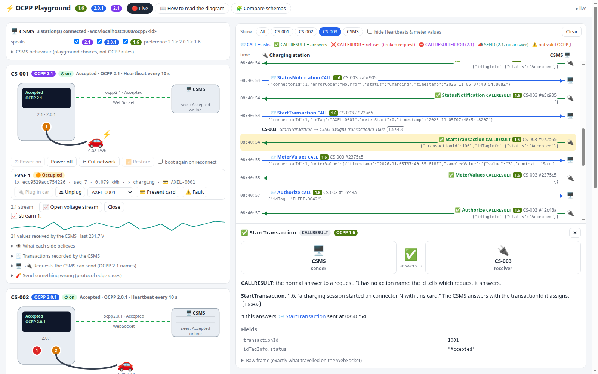
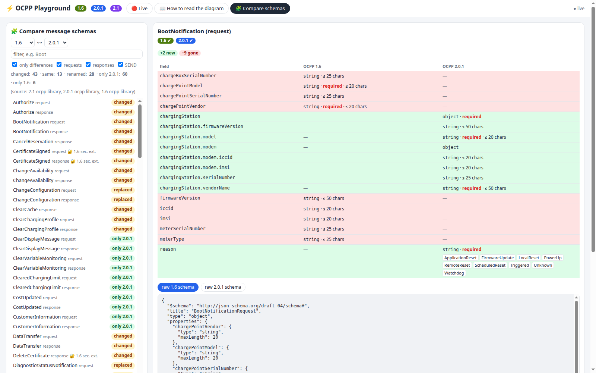
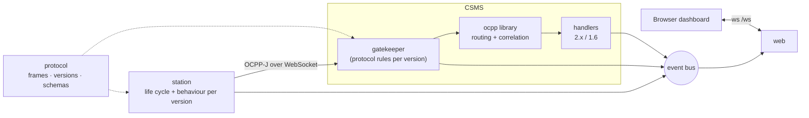

# OCPP Playground

**A mini CSMS, simulated charging stations and a live, picture-based dashboard for OCPP 1.6, 2.0.1 and 2.1.**

See who sends what to whom, message by message. Then break the rules on purpose and see what the specification says
should happen.


- **Real protocol:** stations and CSMS exchange real OCPP-J frames over WebSocket (`ws://localhost:9000/ocpp/<id>`),
  validated against the official JSON schemas. You can watch the same traffic in Wireshark.
- **Three versions side by side:** the version is negotiated through the WebSocket subprotocol (`ocpp2.1`,
  `ocpp2.0.1`, `ocpp1.6`). Each connection then uses its own messages, error codes and rules. The 2.1-only frame types
  **CALLRESULTERROR [5]** and **SEND [6]** are included.
- **Pictures, not just logs:** every station is drawn with its screen, connectors, cars on the cables and its live link to
  the CSMS. Next to it: what the *station* believes vs what the *CSMS* believes.
- **Click to understand:** click any arrow to see who sent it to whom, what kind of message it is, what it means, what it
  answers, and every field. A dedicated tab explains how to read a message-exchange diagram.
- **Spec references everywhere:** each protocol decision carries its reference (`B02.FR.09`, `1.6 §4.8`,
  `Part 4 §4.2.3`…). Playground choices are labelled as such ([conformance notes](docs/conformance.md)).
- **Optional behaviour you can switch:** every choice the specifications leave open for the simulated use cases,
  per station and per version (2.1 status via NotifyEvent or the deprecated StatusNotification, TxStartPoint /
  TxStopPoint, authorization cache, offline and remote-start rules, invalid-id handling, measurands, clock-aligned
  values, clock source, 1.6 MinimumStatusDuration…) and on the CSMS (actions while Pending, report after Accepted,
  cache expiry). Device Model variables / 1.6 keys can also be changed by the CSMS. Full list with references in
  [conformance notes](docs/conformance.md#optional-behaviour-you-can-switch).
- **Schema comparison:** any two of 1.6 / 2.0.1 / 2.1, field by field, including which 1.6 messages were replaced in 2.x.

| Click an arrow                                | Compare versions                                     |
| --------------------------------------------- | ---------------------------------------------------- |
|  |  |

## Quick start

```bash
python3 -m venv .venv && . .venv/bin/activate
pip install -r requirements.txt
python -m playground            # then open http://localhost:8000
```

Options: `--host`, `--csms-port 9000`, `--ui-port 8000`, `--no-autostart`, and
`--schemas VERSION=DIR` to use the official OCA schema files instead of the library's ([why](docs/schema-provenance.md)).
Tests: `python -m unittest` (54 tests, about 25 s).

Three stations exist at start-up: **CS-001** speaks 2.1 + 2.0.1 and powers on by itself, **CS-002** speaks 2.0.1
(2 EVSEs), **CS-003** speaks 1.6 (2 connectors). Add more from the dashboard.

## What you can do

| Area                  | Features                                                                                                                                                                                                                                                            |
| --------------------- | ------------------------------------------------------------------------------------------------------------------------------------------------------------------------------------------------------------------------------------------------------------------- |
| **Registration**      | Accepted, Rejected, Pending forever, or Pending for N s then Accepted / Rejected; while Pending the CSMS reads settings, asks for a report, sets the heartbeat and triggers a new boot. Then connector status (1.6/2.0.1 StatusNotification, 2.1 NotifyEvent AvailabilityState), the boot security event (2.x) and Heartbeats. SecurityError for requests before Accepted |
| **Connection**        | Version negotiation and refusal, network cut, randomised doubling back-off, reconnect without BootNotification, status reporting after an outage                                                                                                                    |
| **2.x sessions**      | TransactionEvent Started / Updated / Ended: cable first, card first, remote start/stop, card stop, cable pulled, fault, reset. Station-generated ids, `seqNo` gap detection, offline queue with `offline: true`                                                     |
| **1.6 sessions**      | Preparing → StartTransaction (**CSMS-assigned id**) → Charging → MeterValues → StopTransaction → Finishing → Available, including offline starts that get their id after the reconnect                                                                              |
| **CSMS → station**    | One button per purpose, with the right message per version: GetVariables / GetConfiguration, SetVariables / ChangeConfiguration, GetBaseReport, Reset, TriggerMessage, ChangeAvailability (incl. *Scheduled*), Request/RemoteStart/StopTransaction, UnlockConnector |
| **OCPP 2.1**          | Periodic event streams with **SEND** (never answered, live chart) and **CALLRESULTERROR** for a broken answer (fault injection)                                                                                                                                     |
| **Protocol mistakes** | 12 buttons: unknown or unsupported action, bad enum, wrong type, missing field, malformed JSON, unreadable id, id over 36 characters, reused id, unknown MessageTypeId, SEND before 2.1, request before Accepted. Each version answers in its own way               |
| **CSMS policy**       | Versions enabled, registration answer and Pending duration, actions while Pending, intervals, report after Accepted, cache expiry, answer or drop unreadable frames, duplicate ids, Authorize detail level, fault injection |

Guided exercises: [docs/experiments.md](docs/experiments.md).

## How it's built



Every incoming frame passes a **gatekeeper** before the [`ocpp`](https://github.com/mobilityhouse/ocpp) library sees
it. It's a pure, unit-tested function that applies the OCPP-J and registration rules of the negotiated version, with
references, and handles the 2.1 frame types the library doesn't know. More diagrams: [docs/architecture.md](docs/architecture.md).

```
playground/
├── protocol/   frames.py (OCPP-J, 5 frame types) · versions.py (1.6 / 2.0.1 / 2.1) · schemas.py (validation, comparison)
├── csms/       server.py (WebSocket server) · gatekeeper.py (rules) · handlers.py (2.x / 1.6) · commands.py · state.py
├── station/    simulator.py (life cycle) · behaviour.py (2.x / 1.6 messages) · handlers.py · model.py
├── web/        server.py (static + WebSocket API) · static/ (index.html, app.js, style.css)
├── tools/      schema_report.py · verify_schemas.py
├── events.py   event bus
└── app.py      wiring + CLI
tests/          test_protocol.py · test_gatekeeper.py · test_end_to_end.py
docs/           architecture · protocol flows · conformance · versions compared · schema provenance · experiments
```

## Documentation

| Document                                                    | Content                                                                                                             |
| ----------------------------------------------------------- | ------------------------------------------------------------------------------------------------------------------- |
| [architecture.md](docs/architecture.md)                     | System view, layers, what changes per version, gatekeeper decision tree, station behaviours, state model            |
| [protocol-flows.md](docs/protocol-flows.md)                 | Sequence and state diagrams for every flow, 2.x and 1.6                                                             |
| [conformance.md](docs/conformance.md)                       | Each behaviour per version, tagged OCA rule / playground decision / open question, plus things noticed in the specs |
| [ocpp-versions-compared.md](docs/ocpp-versions-compared.md) | Generated comparison of the 1.6, 2.0.1 and 2.1 schemas                                                              |
| [schema-provenance.md](docs/schema-provenance.md)           | The library's schemas vs the official OCA files                                                                     |
| [experiments.md](docs/experiments.md)                       | Guided "predict, then click" exercises                                                                              |

## Scope and caveats

- A learning and testing tool, **not** a production CSMS: no TLS or security profiles, no persistence, a single process.
- Not certified and not affiliated with the Open Charge Alliance. Specification references are paraphrased; the OCPP
  documents are published by the [Open Charge Alliance](https://openchargealliance.org/).
- Simplifications are listed as *Decision* rows in [docs/conformance.md](docs/conformance.md).

## Requirements

Python ≥ 3.10, [`ocpp`](https://pypi.org/project/ocpp/) ≥ 2.1 (message classes and schemas for 1.6, 2.0.1 and 2.1),
[`websockets`](https://pypi.org/project/websockets/) ≥ 14, `jsonschema`.
