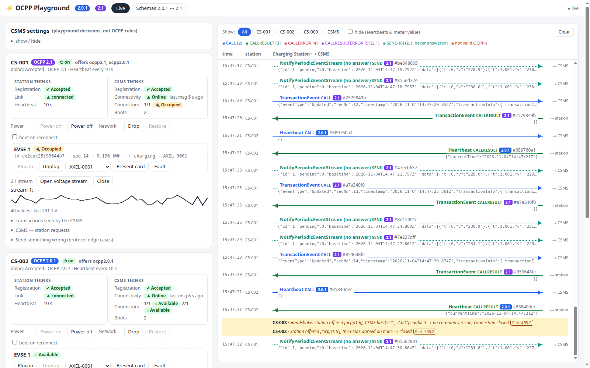
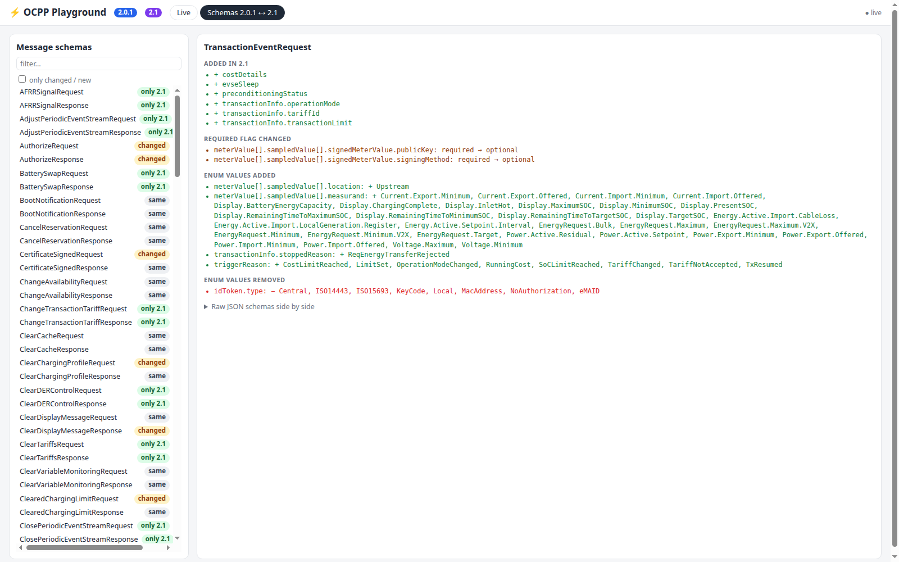
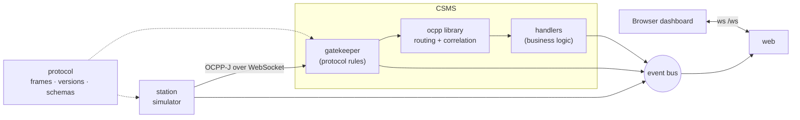

# OCPP Playground

**A mini CSMS, simulated charging stations and a live sequence-diagram dashboard for OCPP 2.0.1 and OCPP 2.1.**

Watch a charging station and its backend talk, frame by frame. Then break the rules on purpose and see what the
specification says should happen.



- **Real protocol:** stations and CSMS exchange real OCPP-J frames over WebSocket (`ws://localhost:9000/ocpp/<id>`),
  validated against the official JSON schemas. You can watch the same traffic in Wireshark.
- **Two versions side by side:** version negotiation through the WebSocket subprotocol (`ocpp2.1`, `ocpp2.0.1`,
  `ocpp1.6` refused), and the 2.1-only frame types **CALLRESULTERROR [5]** and **SEND [6]**.
- **Two points of view:** each station card shows what the *station* thinks next to what the *CSMS* thinks.
- **Spec references everywhere:** each protocol decision on screen carries its reference (`B02.FR.09`,
  `Part 4 §4.2.3`, …). Playground choices are labelled as such ([conformance notes](docs/conformance.md)).
- **Schema explorer:** a tab comparing all 181 message schemas between 2.0.1 and 2.1.



## Quick start

```bash
python3 -m venv .venv && . .venv/bin/activate
pip install -r requirements.txt
python -m playground            # then open http://localhost:8000
```

Options: `--host`, `--csms-port 9000`, `--ui-port 8000`, `--no-autostart`. Tests: `python -m unittest` (40 tests,
about 20 s).

Three stations are created at start-up: **CS-001** offers 2.1 + 2.0.1 and powers on by itself, **CS-002** offers only
2.0.1 (2 EVSEs), **CS-003** offers only 1.6 (refused). Add more from the dashboard.

## What you can do

| Area | Features |
|---|---|
| **Boot** (B01–B04) | Pending → Accepted → StatusNotification per connector → Heartbeats. Rejected, retry intervals, Pending restrictions, SecurityError for anything sent before Accepted |
| **Connection** (Part 4 §3, §5) | Subprotocol negotiation, network drop, randomised doubling back-off, reconnect without BootNotification, B04 reporting after an outage |
| **Transactions** (C, E, F) | Cable-first, card-first, remote start/stop, stop by the same card, cable pulled, fault, reset. Station-generated transaction ids, `seqNo` gap detection, offline queue with `offline: true` |
| **CSMS → station** | GetVariables, SetVariables, GetBaseReport → NotifyReport, Reset, TriggerMessage, ChangeAvailability (incl. *Scheduled*), RequestStart/StopTransaction |
| **OCPP 2.1** | Periodic event streams: OpenPeriodicEventStream + **SEND** NotifyPeriodicEventStream (never answered, live sparkline). **CALLRESULTERROR** when an answer is schema-invalid (fault injection) |
| **Protocol mistakes** | 12 buttons: unknown action, unsupported action, bad enum, wrong type, missing field, malformed JSON, unreadable id, id longer than 36 chars, reused id, unknown MessageTypeId, SEND on 2.0.1, request before Accepted |
| **CSMS policy** | Enabled versions and preference, registration answer, intervals, drop vs answer unreadable frames, duplicate-id handling, Authorize detail level, fault injection |

Guided exercises: [docs/experiments.md](docs/experiments.md).

## How it's built



Every incoming frame passes a **gatekeeper** before the [`ocpp`](https://github.com/mobilityhouse/ocpp) library sees
it. It's a pure, unit-tested function that applies the OCPP-J and registration rules explicitly (with references), and
handles the 2.1 frame types the library doesn't know. Details and more diagrams: [docs/architecture.md](docs/architecture.md).

```
playground/
├── protocol/        frames.py (OCPP-J parsing, 5 frame types) · versions.py (2.0.1 / 2.1) · schemas.py (validation, diffs)
├── csms/            server.py (WebSocket server, handshake) · gatekeeper.py (rules) · handlers.py · commands.py · state.py
├── station/         simulator.py (life cycle, transactions, back-off, streams) · handlers.py · model.py
├── web/             server.py (static + WebSocket API) · static/ (index.html, app.js, style.css)
├── tools/           schema_report.py (generates docs/ocpp-2.0.1-vs-2.1.md)
├── events.py        event bus
└── app.py           wiring + CLI
tests/               test_protocol.py · test_gatekeeper.py · test_end_to_end.py
docs/                architecture · protocol flows · conformance · experiments · 2.0.1 vs 2.1
```

## Documentation

| Document | Content |
|---|---|
| [architecture.md](docs/architecture.md) | System view, layers, gatekeeper decision tree, version handling, state model, event flow |
| [protocol-flows.md](docs/protocol-flows.md) | Sequence and state diagrams for every implemented flow |
| [conformance.md](docs/conformance.md) | Each behaviour tagged as OCA rule, playground decision or open question, plus things noticed in the specs |
| [ocpp-2.0.1-vs-2.1.md](docs/ocpp-2.0.1-vs-2.1.md) | Generated schema comparison (84 identical, 44 changed, 53 new in 2.1) |
| [experiments.md](docs/experiments.md) | Guided "predict, then click" exercises |

## Scope and caveats

- A learning and testing tool, **not** a production CSMS: no TLS or security profiles, no persistence, a single process.
- Not certified and not affiliated with the Open Charge Alliance. Specification references are paraphrased. The OCPP
  specification documents are published by the [Open Charge Alliance](https://openchargealliance.org/). The JSON
  schemas used here ship with the `ocpp` Python library.
- Simplifications are listed as *Decision* rows in [docs/conformance.md](docs/conformance.md).

## Requirements

Python ≥ 3.10, [`ocpp`](https://pypi.org/project/ocpp/) ≥ 2.1 (provides the 2.0.1 and 2.1 message classes and
schemas), [`websockets`](https://pypi.org/project/websockets/) ≥ 14, `jsonschema`.
