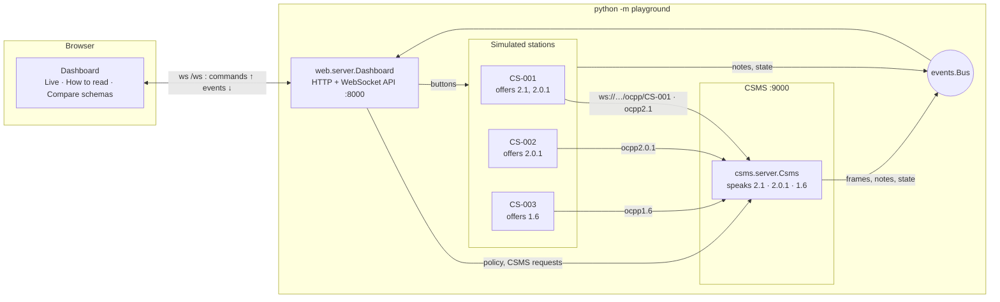
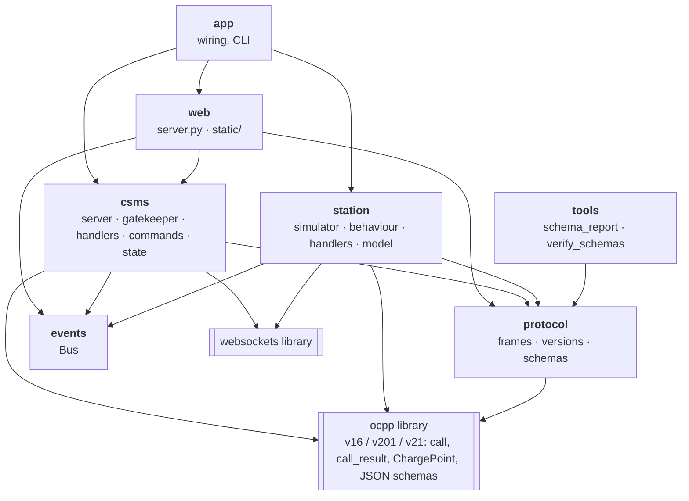
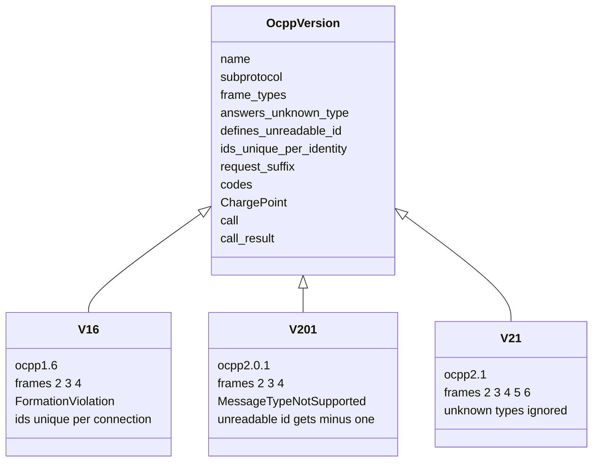
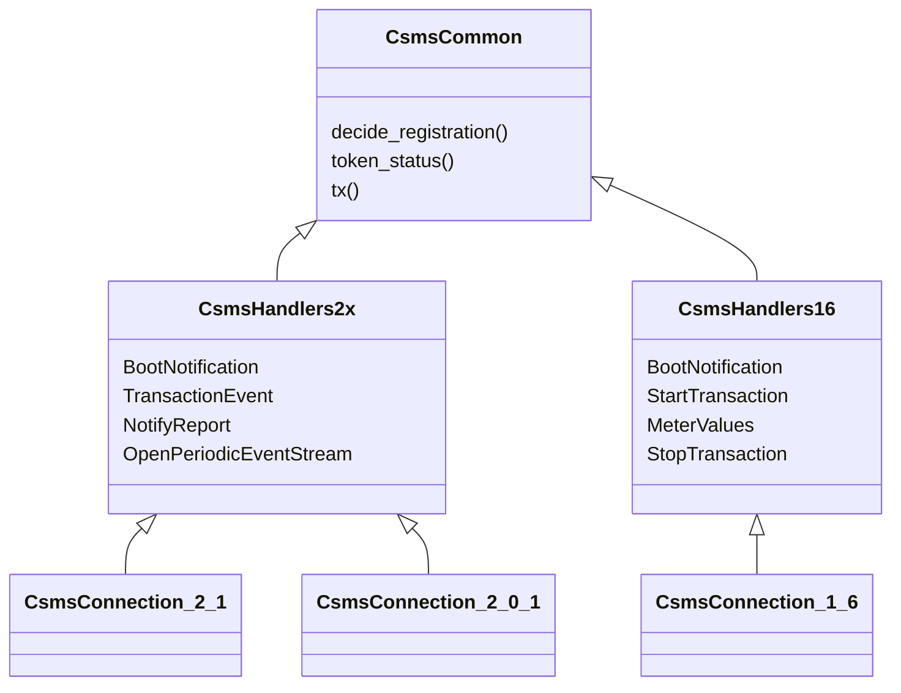
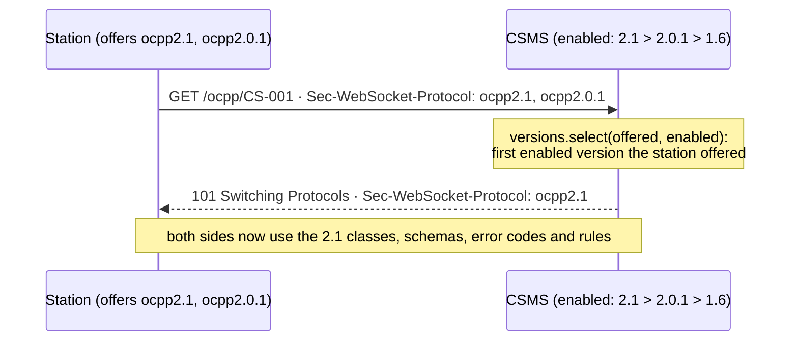
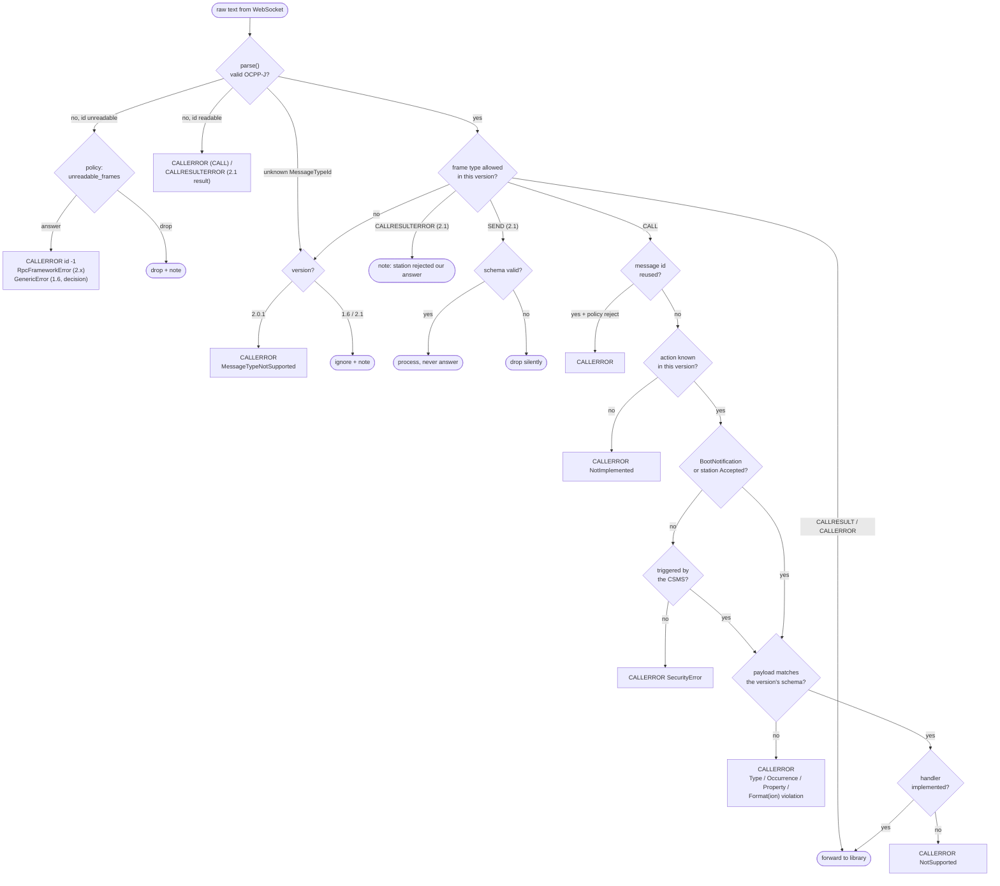
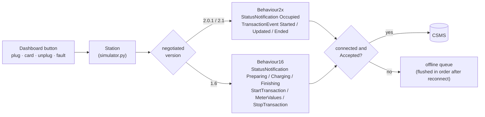
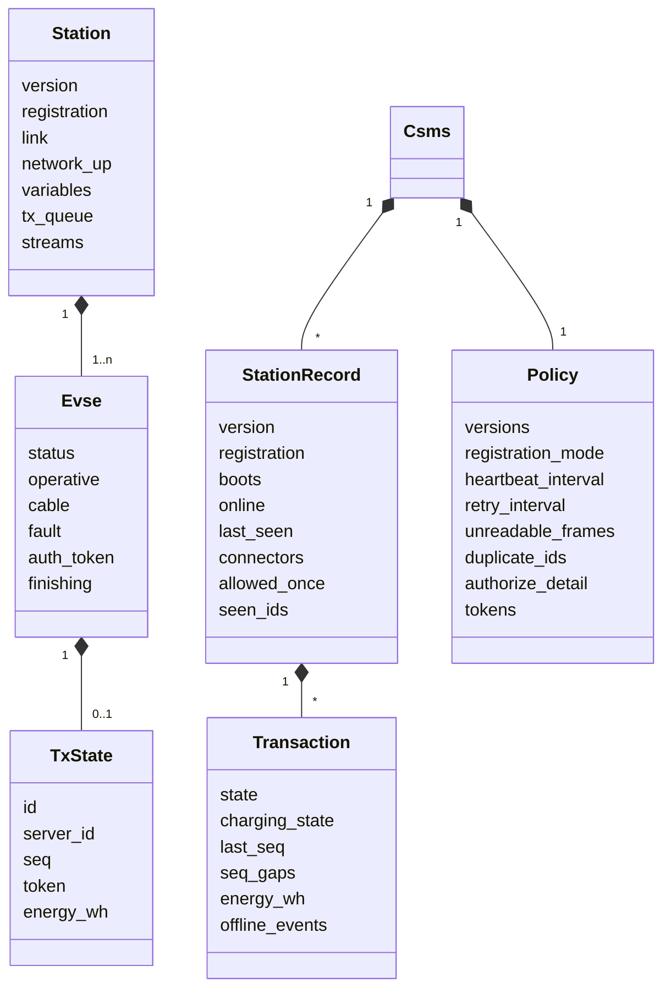
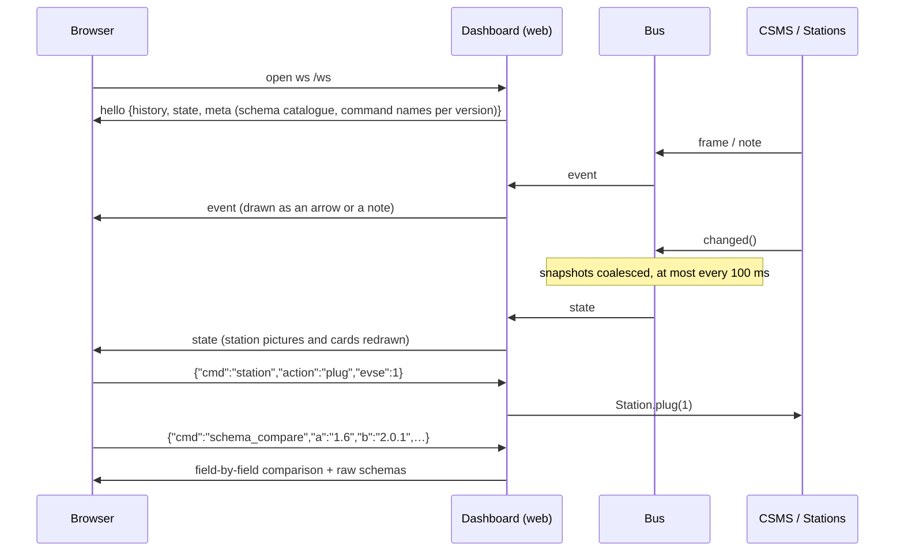

# Architecture

The playground is one Python process with three roles: a **CSMS** (the backend), any number of simulated **charging
stations**, and a **dashboard**. The stations and the CSMS talk over **real WebSocket connections** (OCPP-J), exactly as
they would across the internet. Capture the traffic with Wireshark on the loopback interface (`tcp.port == 9000`).

Three protocol versions run side by side: **OCPP 1.6**, **2.0.1** and **2.1**. The version of each connection is
negotiated in the WebSocket handshake, and everything after that (vocabulary, error codes, schemas, rules) follows it.

## 1. System view

## 2. Layers and packages

Dependencies point downwards only. `protocol` knows nothing about networking or state, so it's reusable and easy to
unit-test.

| Package | File | Responsibility |
|---|---|---|
| `protocol` | `frames.py` | Parse/serialise the five OCPP-J frame types; detect malformed frames (logical error names) |
| | `versions.py` | `OcppVersion` for **1.6, 2.0.1, 2.1**: subprotocol, frame types, error-code vocabulary, rules that differ, library modules, negotiation |
| | `schemas.py` | Load schemas (library or official folder), validate payloads, map JSON-schema keywords to each version's error codes, compare any two versions, 1.6 → 2.x replacements |
| `csms` | `server.py` | WebSocket server, subprotocol negotiation, `GuardedConnection` (logging + gatekeeper + fault injection) |
| | `gatekeeper.py` | **All protocol rules** applied before the library, per version |
| | `handlers.py` | `CsmsHandlers2x` (TransactionEvent, NotifyReport, 2.1 streams) and `CsmsHandlers16` (StartTransaction with CSMS-assigned ids, MeterValues, StopTransaction) |
| | `commands.py` | CSMS → station requests under one generic name each (e.g. `read_heartbeat` = GetVariables in 2.x, GetConfiguration in 1.6) |
| | `state.py` | `Policy` (the knobs) and `StationRecord` / `Transaction` (what the CSMS knows) |
| `station` | `simulator.py` | Version-independent life cycle: connect, boot, reports, heartbeats, offline queue, back-off, 2.1 streams, edge cases |
| | `behaviour.py` | How physical events become messages: `Behaviour2x` (TransactionEvent) vs `Behaviour16` (Start/MeterValues/StopTransaction) |
| | `handlers.py` | How the station answers CSMS requests, per family (`StationHandlers2x`, `StationHandlers16`) |
| | `model.py` | EVSEs/connectors, transactions, status vocabularies (`status_2x`, `status_16`), configuration store |
| `web` | `server.py`, `static/` | Static files + WebSocket API; the dashboard draws stations, the sequence diagram and the schema comparison |
| `events` | `events.py` | Pub/sub bus: frames, notes (with spec reference), throttled state snapshots |
| `tools` | `schema_report.py` | Generates [ocpp-versions-compared.md](ocpp-versions-compared.md) |
| | `verify_schemas.py` | Compares the library's schemas with an official OCA folder ([schema-provenance.md](schema-provenance.md)) |

## 3. What changes with the version

Code never writes an error code as a literal. It asks `version.code("format")`, which returns `FormationViolation`
on 1.6 and `FormatViolation` on 2.x, exactly as each specification spells it.

Handlers are written once per *family* and combined with the library's `ChargePoint` for the negotiated version:

## 4. Why a gatekeeper in front of the `ocpp` library?

The [`ocpp`](https://github.com/mobilityhouse/ocpp) library handles framing, routing and call/response correlation
well. But it only knows message types 2, 3 and 4, and it makes some error-handling choices of its own:

| Situation | `ocpp` library (as used here) | Playground (gatekeeper) | Reference |
|---|---|---|---|
| Unknown action | `NotSupported` (1.6, 2.0.1), **no answer** (2.1) | `NotImplemented` ("action not known") | 1.6 J §4.2.3 · 2.x §4.3 |
| Known action without handler | `NotImplemented` | `NotSupported` ("recognised but not supported") | same tables |
| Unreadable frame | logs, no answer | CALLERROR with id `"-1"` (or drop, configurable) | 2.x §4.2.3 |
| Enum violation | `FormatViolation` | `PropertyConstraintViolation` | error-code tables |
| Missing required field | `ProtocolError` | `OccurrenceConstraintViolation` (2.x) / `OccurenceConstraintViolation` (1.6) | error-code tables |
| MessageTypeId 5 / 6 | not supported | per version: 2.0.1 → MessageTypeNotSupported, 1.6 → ignored, 2.1 → handled | 2.0.1 §4.4 · 1.6 J §4.1.3 |
| Request before Accepted | answered normally | CALLERROR `SecurityError` | B01.FR.10 · B02.FR.09 · B03.FR.07 (2.x) |

Every incoming frame goes through the gatekeeper first. Only what passes reaches the library:

`gatekeeper.inspect()` is a pure function of *(raw text, version, station record, policy, handled actions)*, so every
branch is unit-tested for each version without a network ([tests/test_gatekeeper.py](../tests/test_gatekeeper.py)).

## 5. Station: one life cycle, two vocabularies

The life cycle (connect, boot until Accepted, report connectors, heartbeats, back-off, reconnect) is the same for
every version. Only the messages differ, so they live in `behaviour.py`. A 1.6 transaction queued while offline gets its
`transactionId` from the CSMS only when the queued StartTransaction is finally sent; the later MeterValues and
StopTransaction read that id at send time.

## 6. State: two points of view

The dashboard always shows **what the station thinks** next to **what the CSMS thinks**. Most interesting situations
live in the gap between the two (after a network drop the station still believes it's Accepted, while the CSMS shows it
Offline).

## 7. Dashboard

| Tab | What it shows |
|---|---|
| 🔴 Live | One picture per station (screen, connectors, cars on the cables, live link to the CSMS), controls, and the sequence diagram. Click an arrow for who sent it to whom, what it means, what it answers, every field and the raw frame |
| 📖 How to read the diagram | An annotated example sequence and the five kinds of arrow |
| 🧩 Compare schemas | Any two of 1.6 / 2.0.1 / 2.1, field by field, with replacements and the raw schemas |
