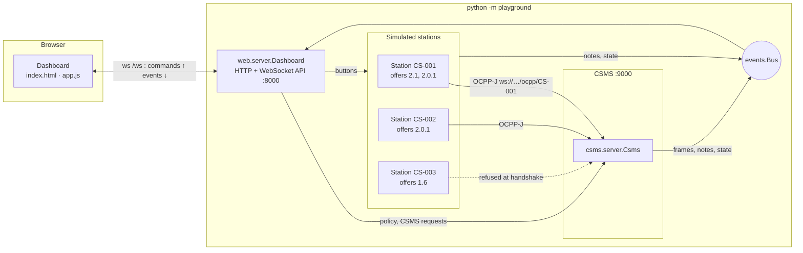
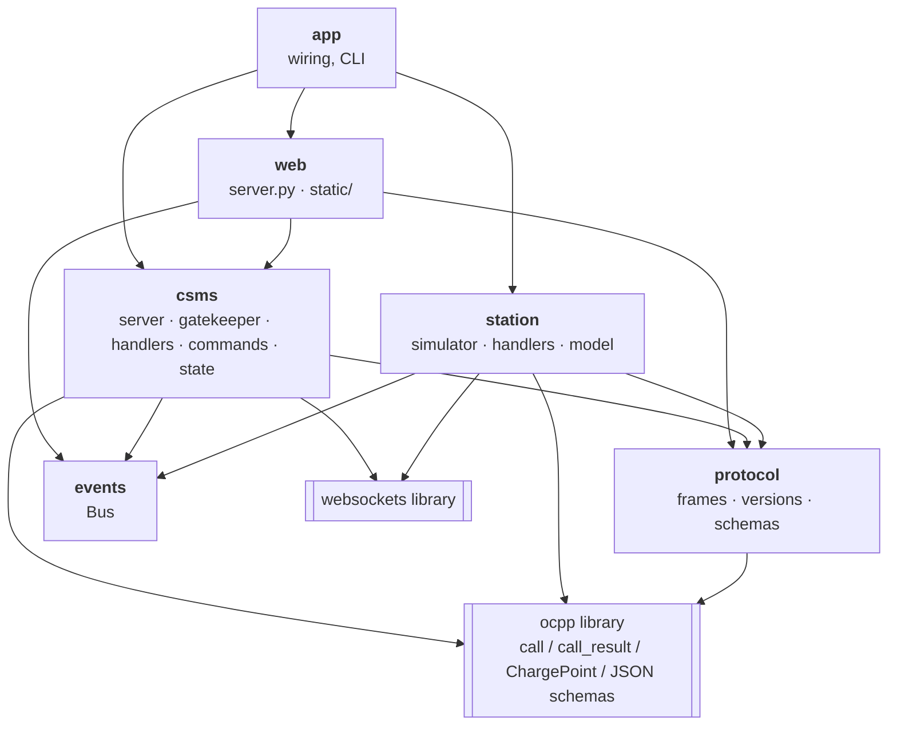
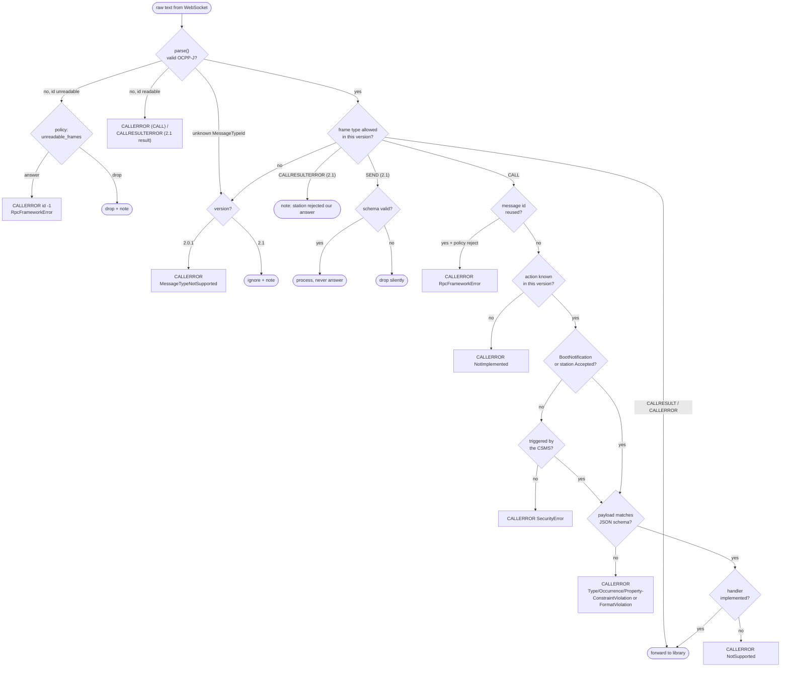
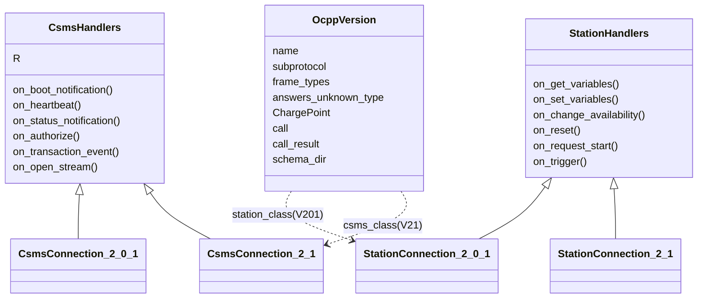
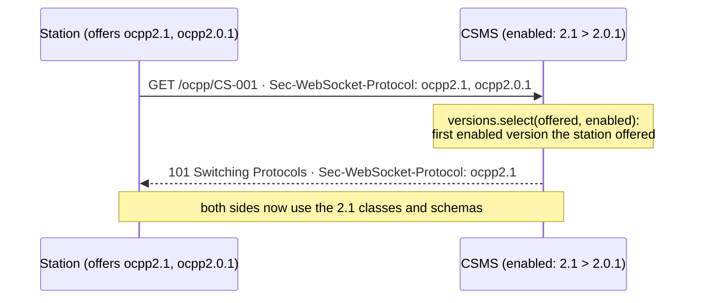
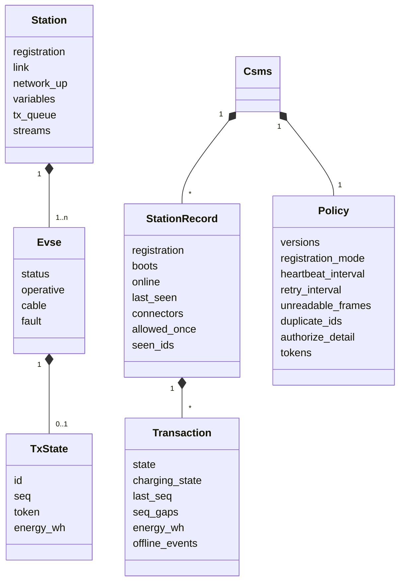
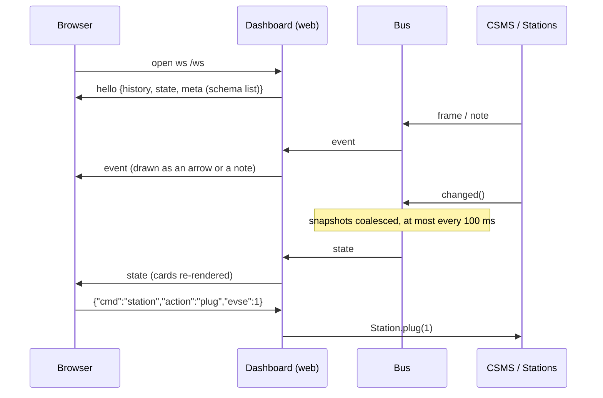

# Architecture

The playground is one Python process with three roles: a **CSMS** (the backend), any number of simulated **charging
stations**, and a **dashboard**. The stations and the CSMS talk to each other over **real WebSocket connections**
(OCPP-J), exactly as they would across the internet. You can capture that traffic with Wireshark on the loopback
interface (`tcp.port == 9000`).

## 1. System view

## 2. Layers and packages

Dependencies point downwards only. `protocol` knows nothing about networking or state, so it's reusable and easy to
unit-test.

| Package | Files | Responsibility |
|---|---|---|
| `protocol` | `frames.py` | Parse/serialise the five OCPP-J frame types; detect malformed frames and pick the RPC error code |
| | `versions.py` | `OcppVersion` objects for 2.0.1 and 2.1: subprotocol, allowed frame types, library modules, negotiation |
| | `schemas.py` | Load the official JSON schemas, validate payloads, map JSON-schema keywords to RPC error codes, diff two versions |
| `csms` | `server.py` | WebSocket server, subprotocol negotiation, `GuardedConnection` (logging + gatekeeper + fault injection) |
| | `gatekeeper.py` | **All protocol rules** applied before the library: frame validity, version frame types, registration gate, schema, NotImplemented / NotSupported |
| | `handlers.py` | Business logic for each station → CSMS request (one mixin, any version) |
| | `commands.py` | CSMS → station requests (GetVariables, Reset, RequestStartTransaction, …), CALLRESULTERROR for bad answers |
| | `state.py` | `Policy` (the knobs) and `StationRecord` / `Transaction` (what the CSMS knows) |
| `station` | `simulator.py` | Station life cycle: connect, boot, reports, heartbeats, transactions, offline queue, back-off, 2.1 streams, edge cases |
| | `handlers.py` | How the station answers CSMS requests (Get/SetVariables, ChangeAvailability, Reset, TriggerMessage, …) |
| | `model.py` | EVSEs, transactions, device-model variables |
| `web` | `server.py`, `static/` | Static files + WebSocket API; the dashboard renders state and draws the sequence diagram |
| `events` | `events.py` | Pub/sub bus: frames, notes (with spec reference), throttled state snapshots |
| `tools` | `schema_report.py` | Generates [ocpp-2.0.1-vs-2.1.md](ocpp-2.0.1-vs-2.1.md) |

## 3. Why a gatekeeper in front of the `ocpp` library?

The [`ocpp`](https://github.com/mobilityhouse/ocpp) library handles framing, routing and call/response correlation
well. But it only knows message types 2, 3 and 4, and it makes some error-handling choices of its own:

| Situation | `ocpp` library (as used here) | Playground (gatekeeper) | Reference |
|---|---|---|---|
| Unknown action | `NotSupported` (2.0.1), **no answer** (2.1) | `NotImplemented` ("action not known") | Part 4 §4.3 |
| Known action without handler | `NotImplemented` | `NotSupported` ("recognised but not supported") | Part 4 §4.3 |
| Unreadable frame | logs, no answer | CALLERROR with id `"-1"` (or drop, configurable) | Part 4 §4.2.3 |
| Enum violation | `FormatViolation` | `PropertyConstraintViolation` | Part 4 §4.3 |
| Missing required field | `ProtocolError` | `OccurrenceConstraintViolation` | Part 4 §4.3 |
| MessageTypeId 5 / 6 | not supported | per version: 2.0.1 → MessageTypeNotSupported, 2.1 → handled | Part 4 §4.1.3, §4.4 |
| Request before Accepted | answered normally | CALLERROR `SecurityError` | B01.FR.10, B02.FR.09, B03.FR.07 |

So every incoming frame goes through the gatekeeper first. Only what passes reaches the library:

`gatekeeper.inspect()` is a pure function of *(raw text, version, station record, policy, handled actions)*, so all of
these branches are unit-tested without a network ([tests/test_gatekeeper.py](../tests/test_gatekeeper.py)).

## 4. Versions: one code base, two protocols

The handler logic is written once as a mixin. `csms_class(version)` and `station_class(version)` combine it with the
library's `ChargePoint` for that version, and set `R` to the matching `call_result` module. The version is picked
during the WebSocket handshake:

## 5. State: two points of view

The dashboard always shows **what the station thinks** next to **what the CSMS thinks**. Most interesting bugs live in
the gap between the two (e.g. after a network drop the station still believes it's Accepted, while the CSMS shows it
Offline).

## 6. Events to the dashboard

