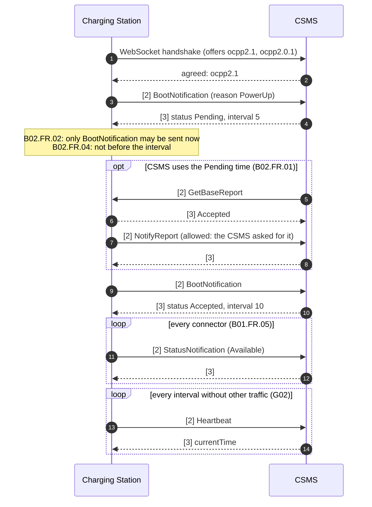
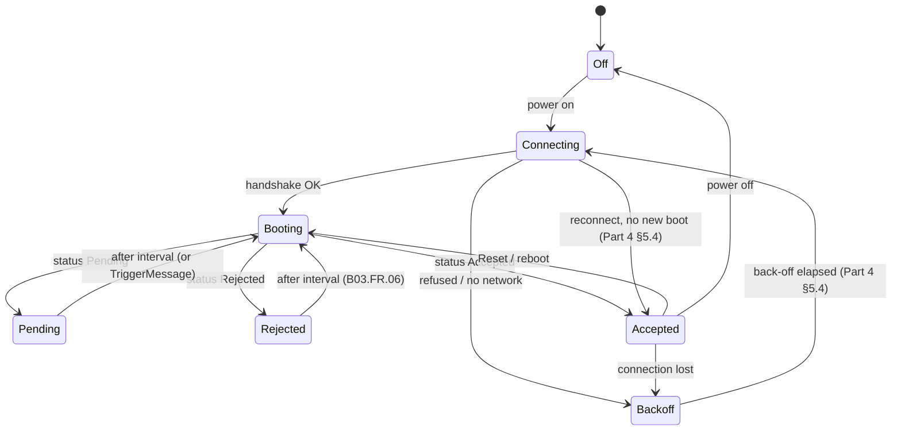
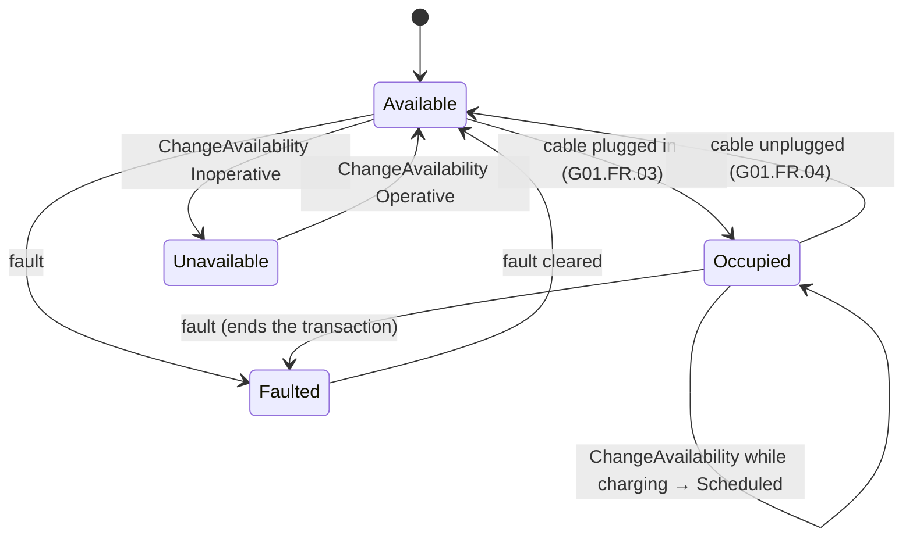
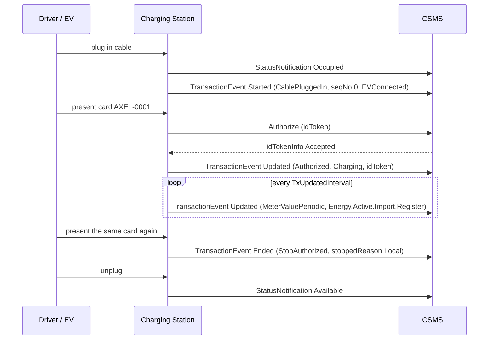
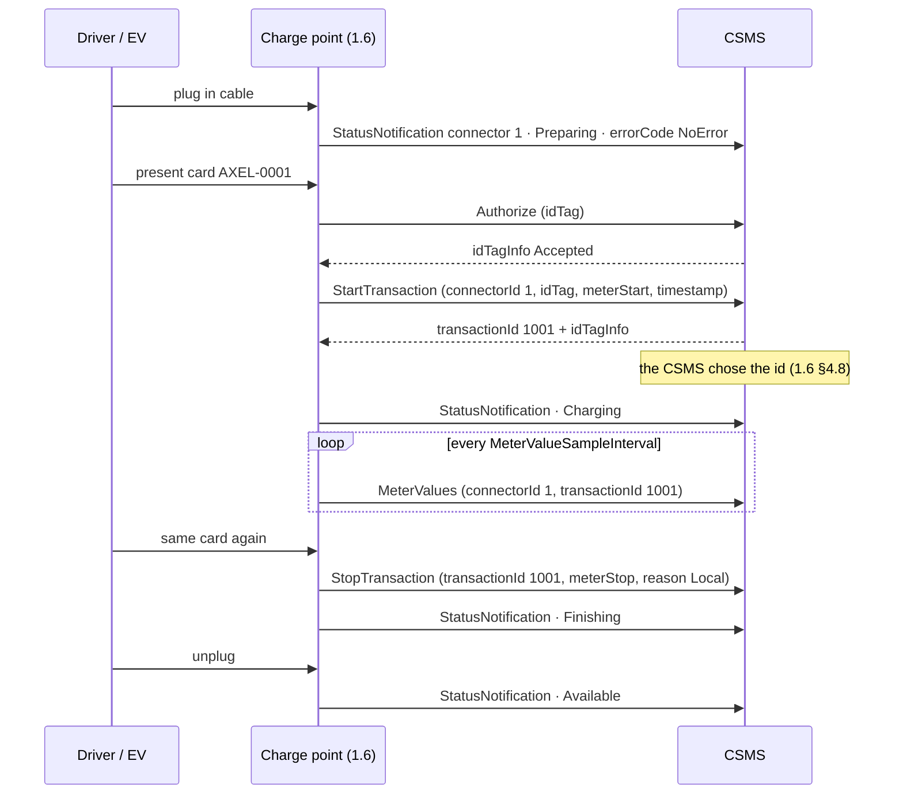
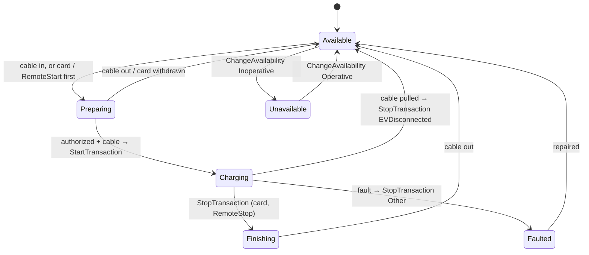
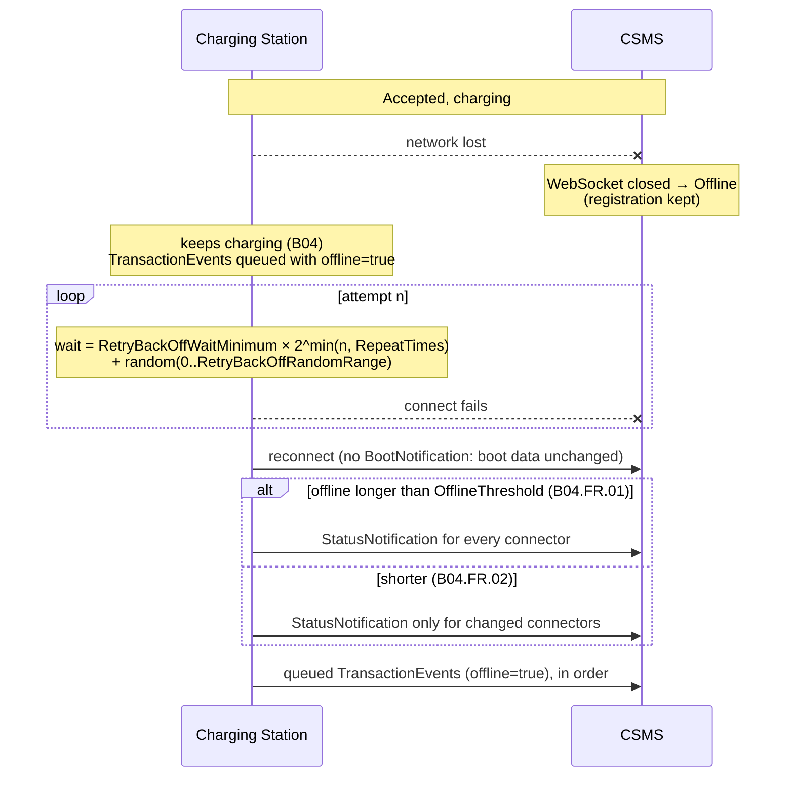
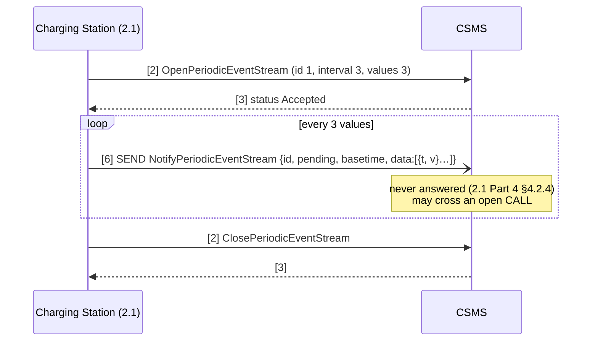
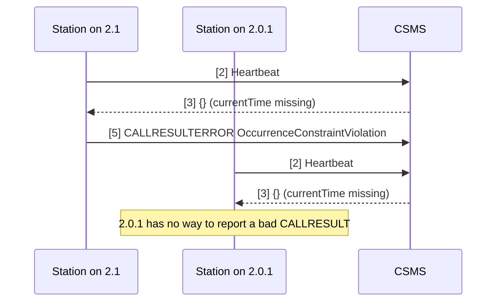

# Protocol flows implemented

Every flow below runs in the playground and is covered by an end-to-end test
([tests/test_end_to_end.py](../tests/test_end_to_end.py)). References point to the OCA specification: **Part 2**
use cases (e.g. `B02.FR.09`) and **Part 4** (OCPP-J) sections. The text is paraphrased, not copied.

## 1. Connect and boot: Pending, then Accepted (B01, B02)

**If a station that isn't Accepted sends anything else**, the CSMS answers `CALLERROR SecurityError`
(B01.FR.10 · B02.FR.09 · B03.FR.07). Try it: put the CSMS on *Pending*, then press *Send something wrong → Heartbeat now*.

## 2. Registration as seen by the station

## 3. Connector status (G01) and availability (G03)

## 4. Transaction: cable first, then card (E02, E07)

The **station** generates the transaction id (Part 0 §2.8.2), and `seqNo` increases by one per event so the CSMS can
detect gaps.

Other start and stop paths in the simulator:

| Path | Trigger | Use case |
|---|---|---|
| Card first, cable later | `Started` with Authorized, chargingState Idle, then `Updated` with CablePluggedIn | E03 |
| Remote start, cable later | RequestStartTransaction → `Started` with RemoteStart and remoteStartId | F02 |
| Remote start, cable already in | RequestStartTransaction → `Updated` with RemoteStart | F01 |
| Remote stop | RequestStopTransaction → `Ended` with RemoteStop, stoppedReason Remote | F03 |
| Cable pulled while charging | `Ended` with EVCommunicationLost, stoppedReason EVDisconnected | E09 |
| Fault while charging | `Ended` with AbnormalCondition, stoppedReason Other | — |
| Reset while charging | `Ended` with ResetCommand, stoppedReason ImmediateReset | B12 |
| Pending station receives RequestStartTransaction | answers `Rejected` | B02.FR.05 |

## 4b. The same session in OCPP 1.6 (1.6 §4.1, §4.7–4.10)

In 1.6 a session is three different messages, the **CSMS** assigns the transaction id, and the connector goes through
more statuses (1.6 §4.9: *Occupied* was split into Preparing, Charging, SuspendedEV/EVSE and Finishing).

At boot a 1.6 charge point also reports **connectorId 0** (the charge point itself, 1.6 §3.8), so the CSMS sees
connectors `0`, `1`, `2`… A transaction started while offline is queued; its id only exists once the queued
StartTransaction reaches the CSMS after the reconnect.

## 5. Connection loss, back-off and offline behaviour (Part 4 §5.4, B04, E04/E12)

## 6. OCPP 2.1: periodic event stream with SEND (N11 scenario 2)

The same `[6, …]` frame sent on a **2.0.1** connection gets `CALLERROR MessageTypeNotSupported`, because 2.0.1 only knows
types 2, 3 and 4 (2.0.1 Part 4 §4.4).

## 7. OCPP 2.1: CALLRESULTERROR

Turn on *Fault injection → HeartbeatResponse without currentTime*. The CSMS then sends a schema-invalid answer, and:

## 8. CSMS → station requests

The dashboard buttons are generic; each one sends the message of the negotiated version:

| Button | 2.0.1 / 2.1 | 1.6 |
|---|---|---|
| read heartbeat | GetVariables(OCPPCommCtrlr.HeartbeatInterval) | GetConfiguration(HeartbeatInterval) |
| set heartbeat | SetVariables | ChangeConfiguration |
| full report | GetBaseReport → NotifyReport later | GetConfiguration() → values in the answer |
| reset | Reset(Immediate) | Reset(Soft) |
| change availability | ChangeAvailability(operationalStatus, evse) | ChangeAvailability(connectorId, type) |
| remote start / stop | RequestStart/StopTransaction | RemoteStart/StopTransaction (not sent while Pending, 1.6 §4.2) |
| unlock | UnlockConnector(evseId, connectorId) | UnlockConnector(connectorId) |

2.x details:

| Dashboard button | Request | Station behaviour |
|---|---|---|
| GetVariables | `GetVariables(OCPPCommCtrlr.HeartbeatInterval)` | Accepted + value, or UnknownComponent / UnknownVariable (B06) |
| SetVariables | `SetVariables(OCPPCommCtrlr.HeartbeatInterval)` | Accepted, or Rejected for read-only (B05). The heartbeat loop picks up the new value |
| GetBaseReport | `GetBaseReport(FullInventory)` | Accepted, then `NotifyReport` with all variables. Allowed while Pending (B07, B02.FR.02) |
| Reset | `Reset(Immediate)` | Accepted, ends transactions, reconnects with BootNotification reason RemoteReset (B11/B12) |
| TriggerMessage | `TriggerMessage(StatusNotification / Heartbeat / BootNotification / MeterValues)` | Accepted and sends it, or NotImplemented (MeterValues) (F06) |
| ChangeAvailability | `ChangeAvailability(Inoperative / Operative)` | Accepted → StatusNotification Unavailable / Available; Scheduled if a transaction runs (G03/G04) |
| RequestStartTransaction | `RequestStartTransaction(EVSE 1, FLEET-0042)` | F01/F02, Rejected while Pending (B02.FR.05) |
| RequestStopTransaction | `RequestStopTransaction(transactionId)` | F03 |

While a station is **Rejected**, the CSMS refuses to send it anything (B03.FR.03).
